## 1. Configuración de los Security Groups encadenados

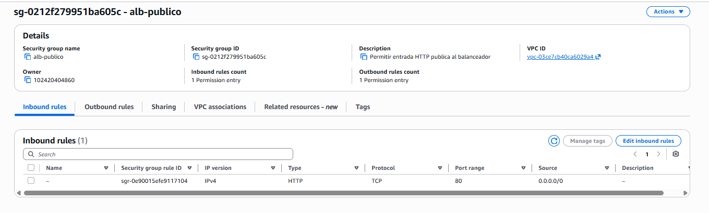

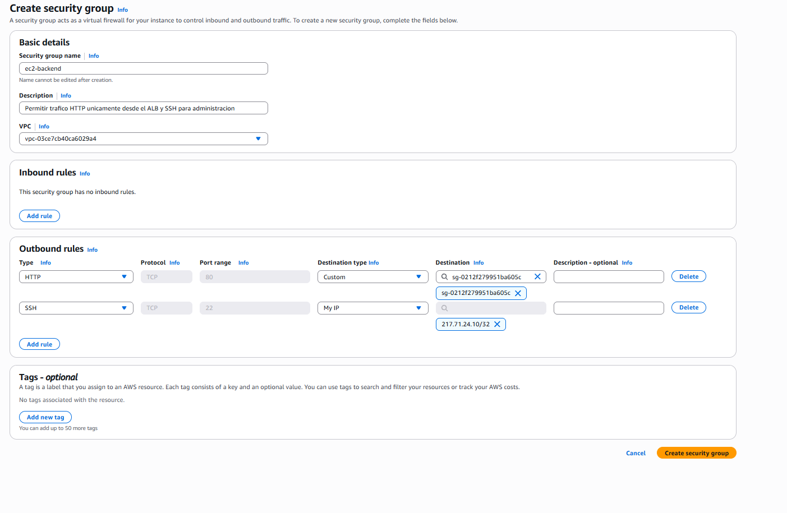

## 2. Creación de la plantilla de lanzamiento

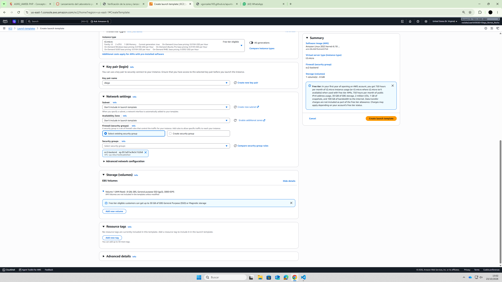

## 3. Creación del Target Group

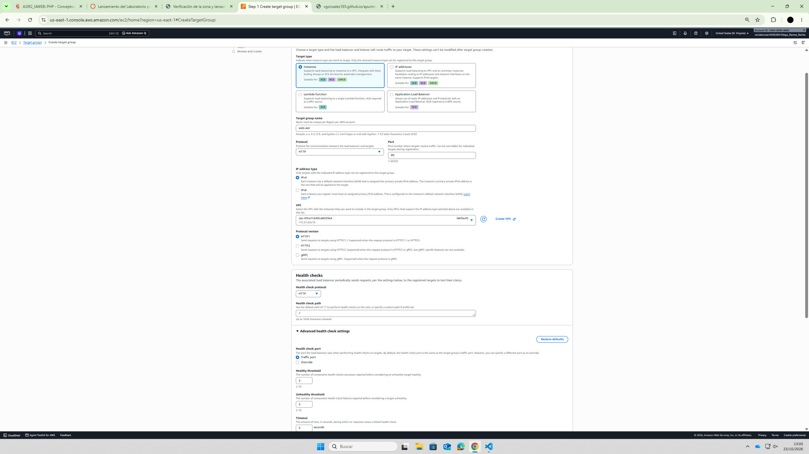

## 4. Creación del Application Load Balancer (ALB)

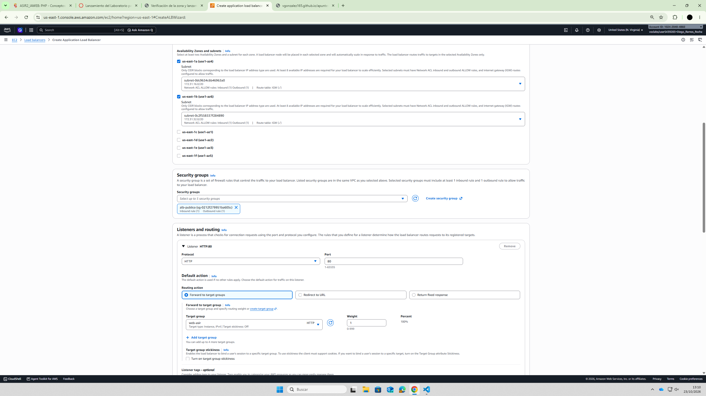

## 5. Creación del Auto Scaling Group (ASG)

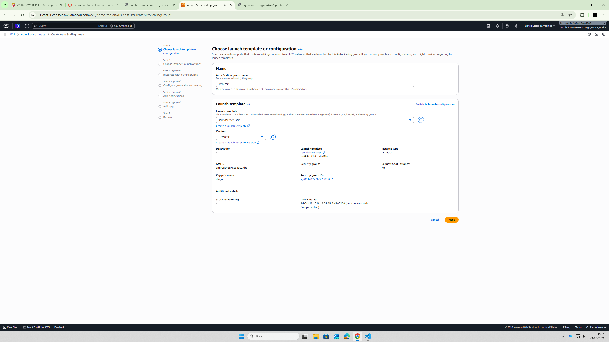

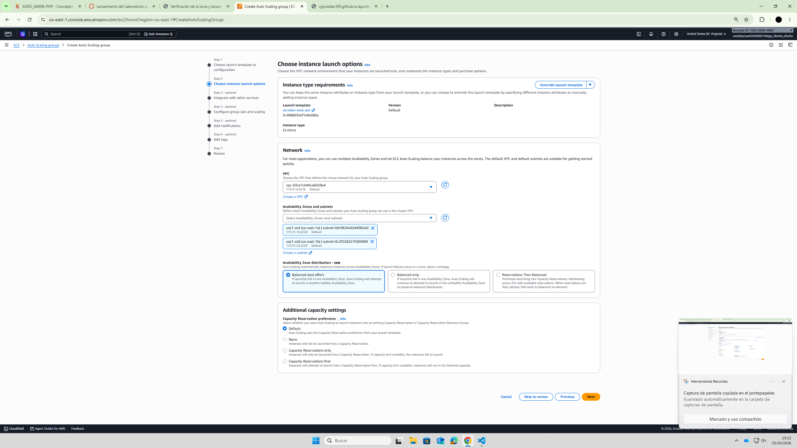

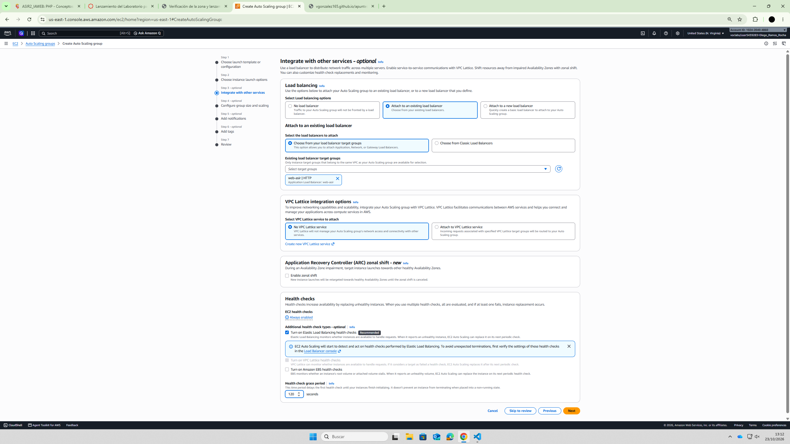

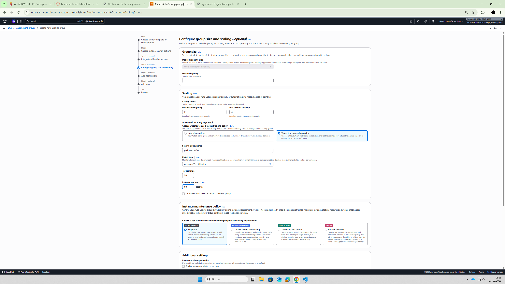

## 6. Verificación del balanceo de carga

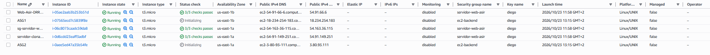

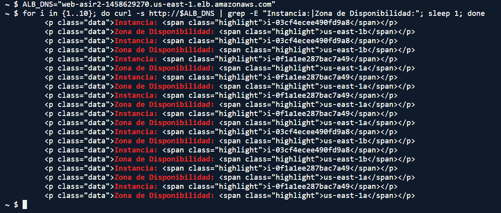

## 7. Prueba de estrés y validación del autoescalado

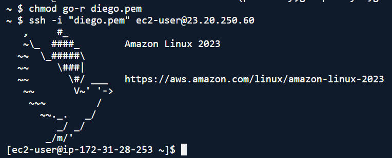

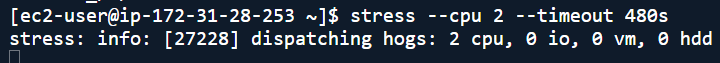

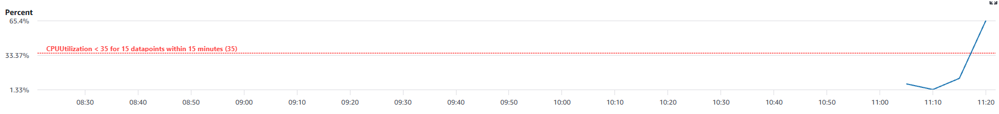

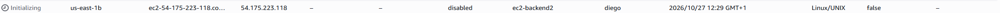