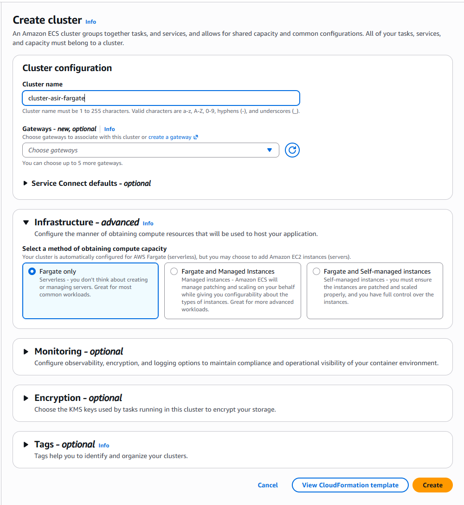
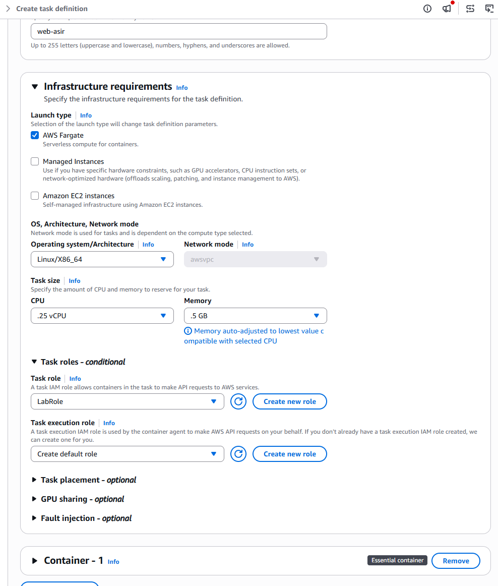
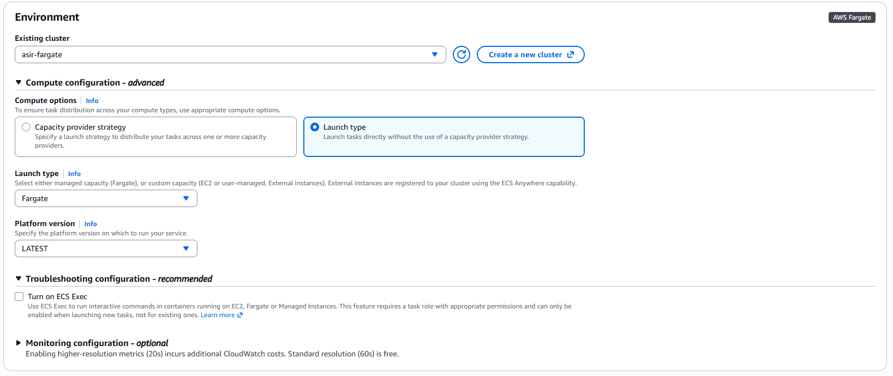
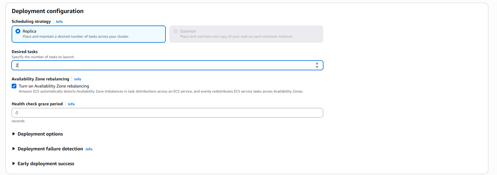
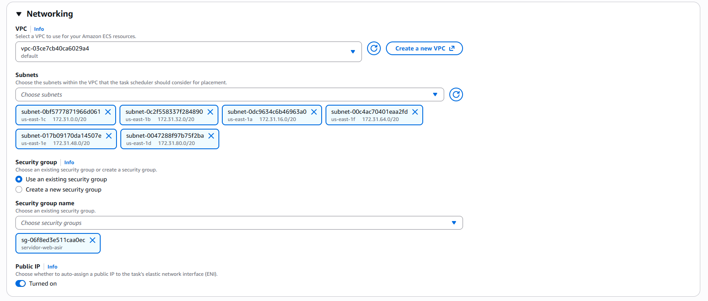
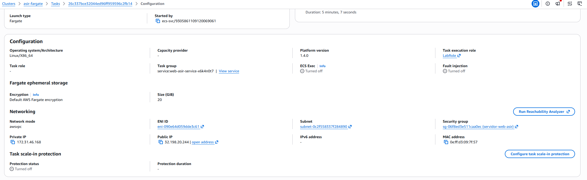
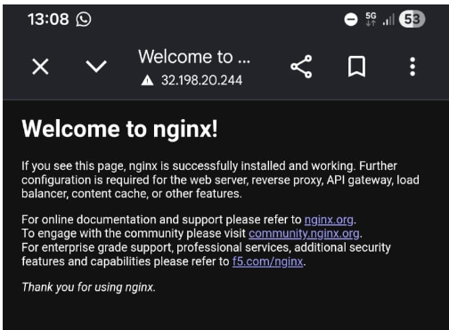
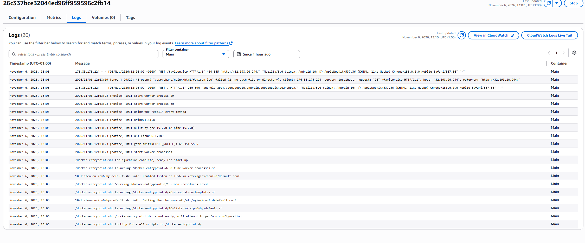
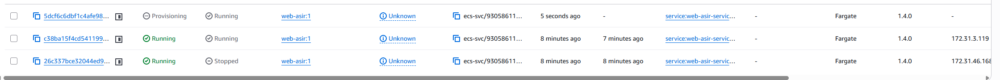

# 1: Creación del clúster ECS con AWS Fargate

# 2. Creación de la Definición de Tarea (Task Definition)

# 3. Despliegue del Servicio ECS

# 4. Verificación y pruebas de acceso

# 5. Monitorización y resiliencia (Self-Healing)

