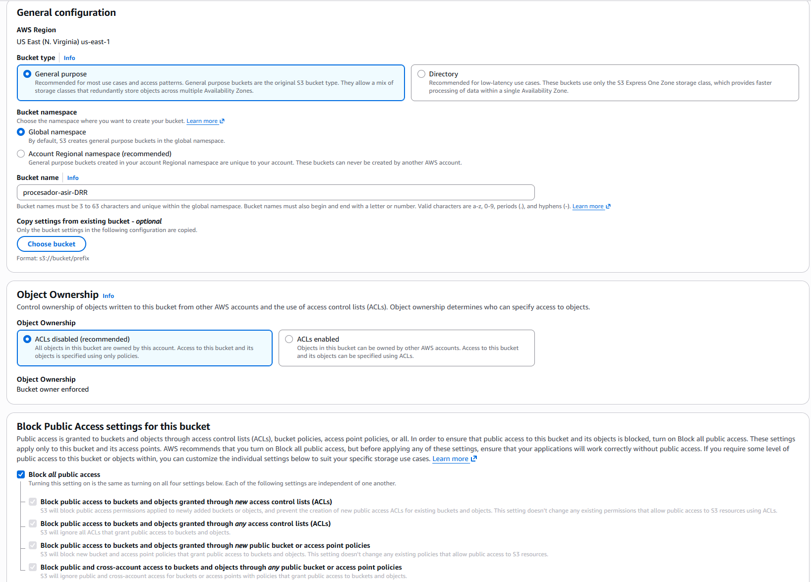
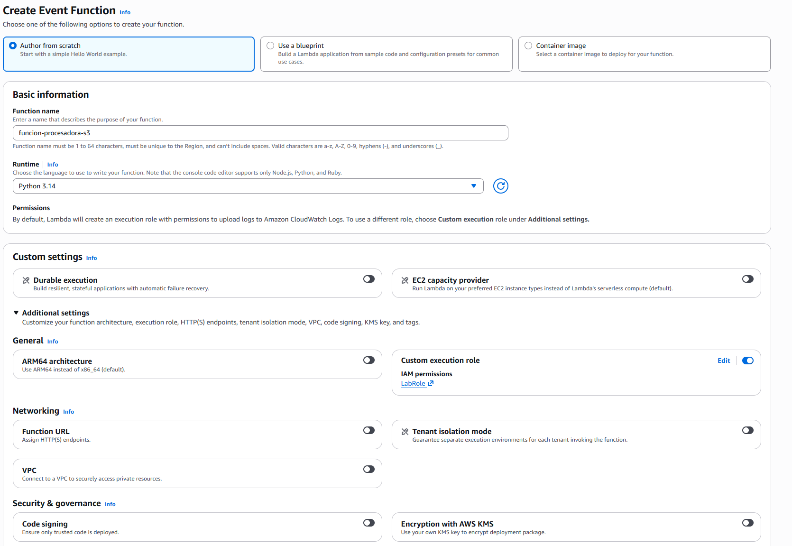
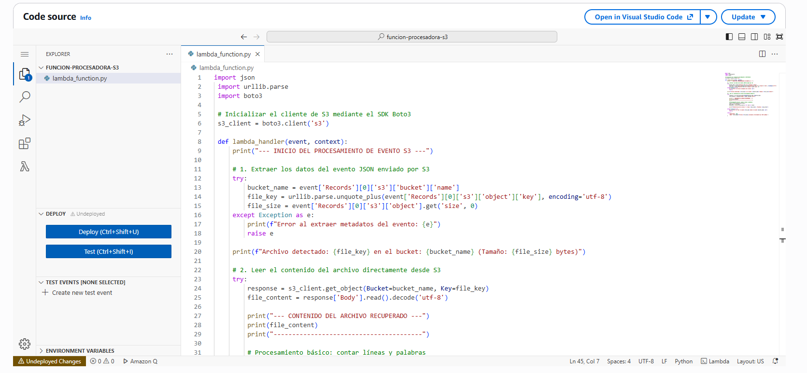
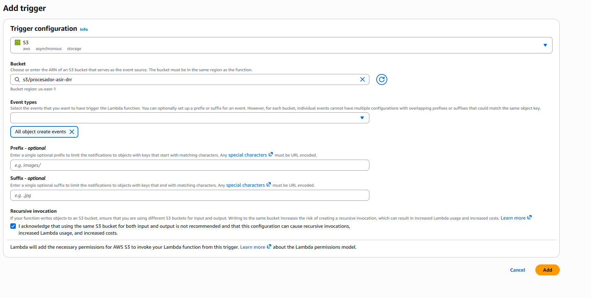
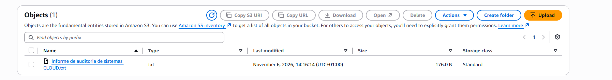
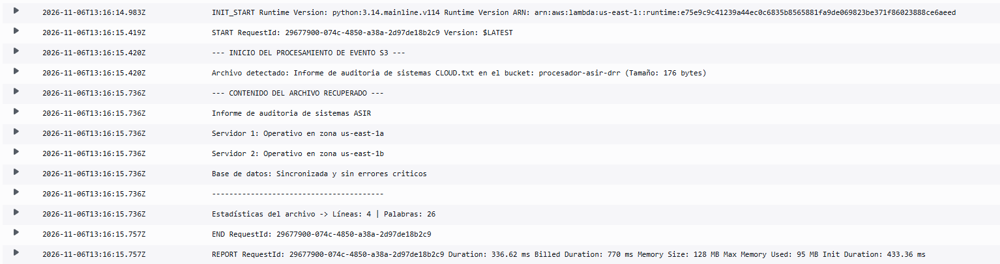

# 1. Creación del Bucket S3 para la ingesta de archivos

# 2. Creación de la función AWS Lambda

# 3. Configuración del disparador (Trigger) de S3

# 4. Creación de archivo de prueba y validación del flujo

# 5. Insepcción de resultados en CloudWatch Logs
