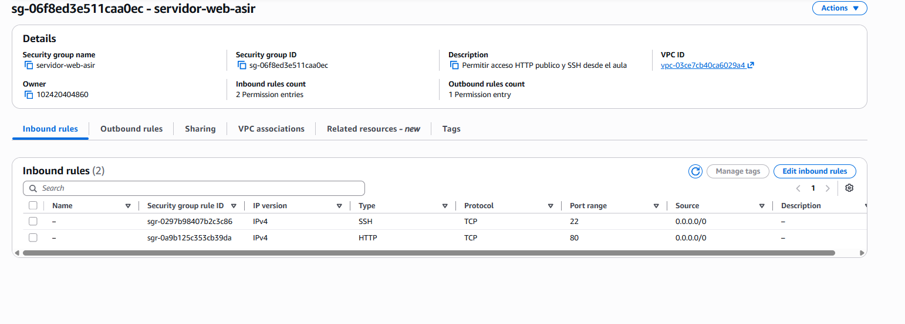
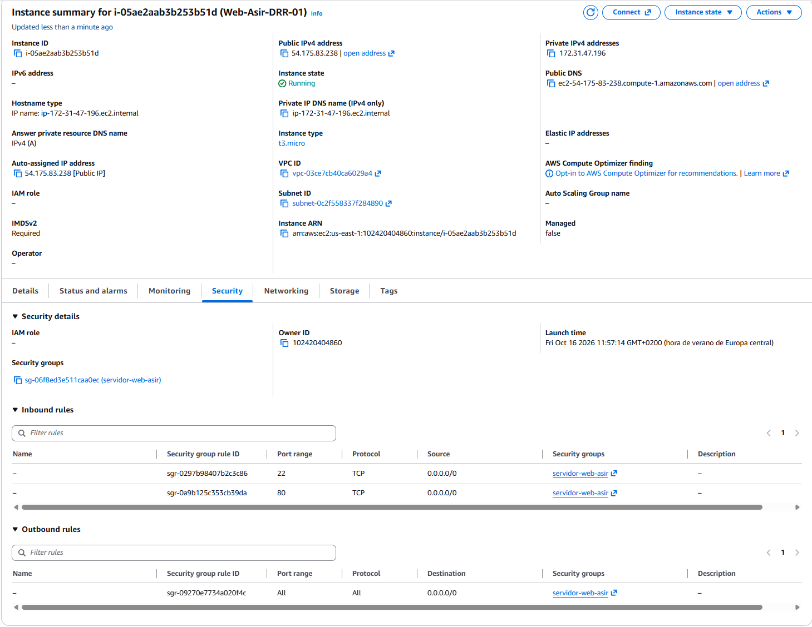
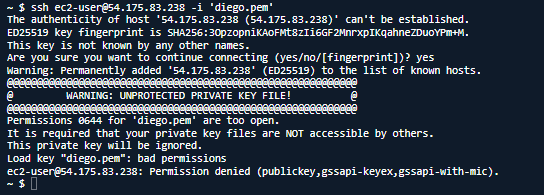
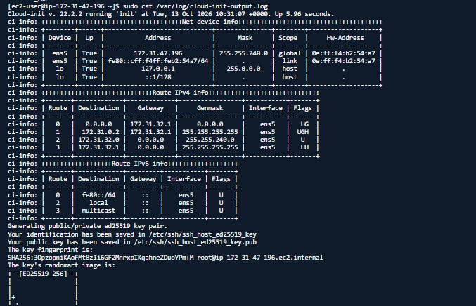
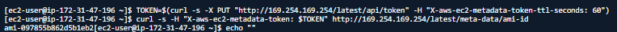

## 1: Creación del Grupo de Seguridad (Security Group)

## Paso 2: Análisis del Script de User Data

## Paso 3: Lanzamiento de la Instancia EC2

## Paso 4: Verificación y resolución de problemas

