## 1. Verificación de la zona y lanzamiento de la máquina base

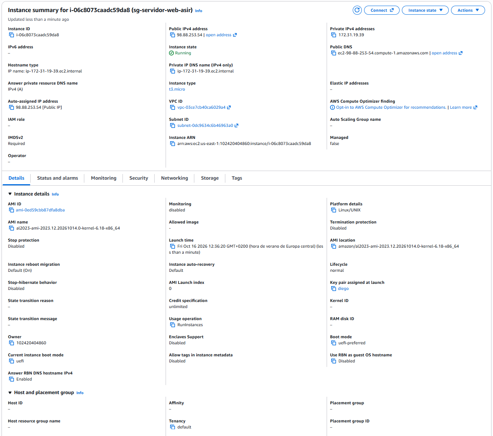

## 2. Creación y conexión del volumen EBS

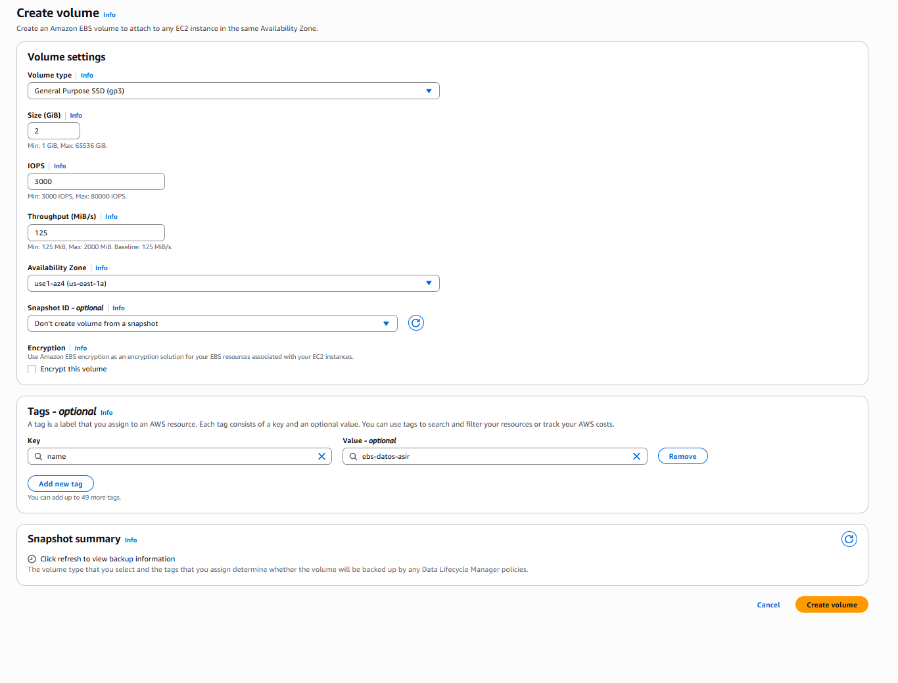

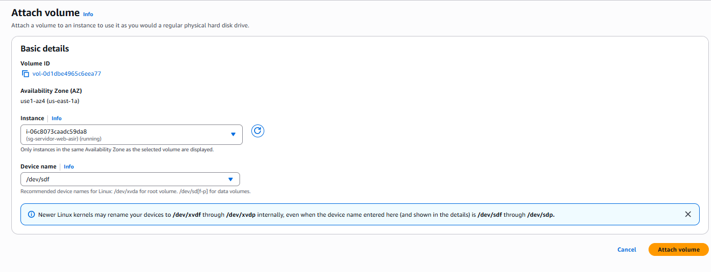

## 3. Configuración del almacenamiento en el sistema operativo

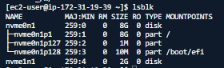

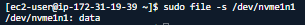

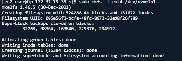

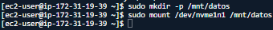

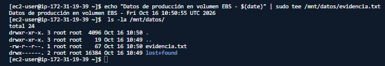

## 4. Automatización del montaje en /etc/fstab mediante UUID

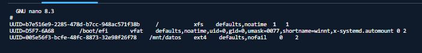

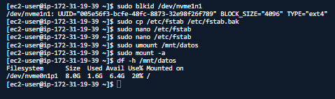

## 5. Creación de la AMI (Amazon Machine Image)

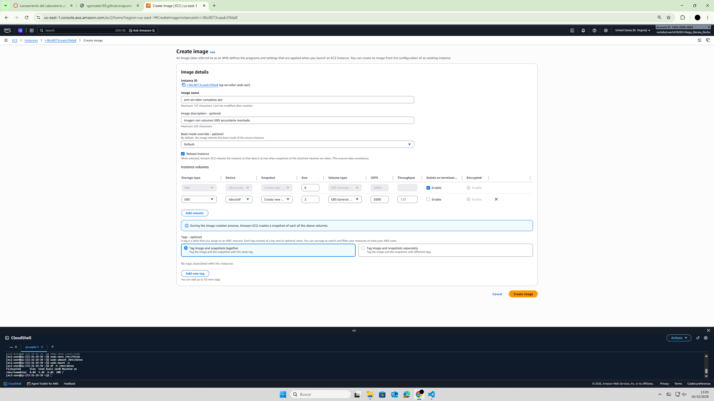

## 6. Lanzamiento y verificación de la instancia clonada

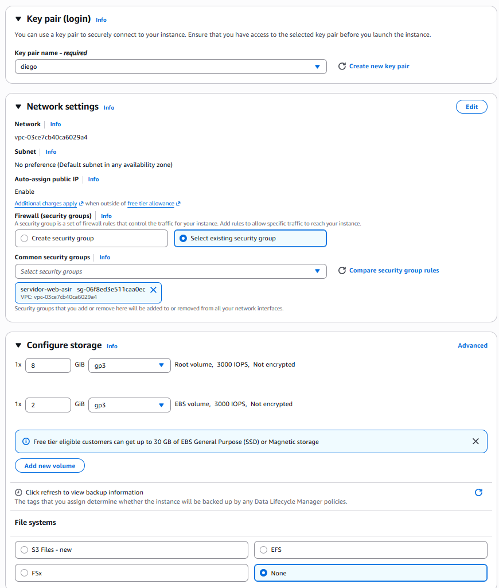

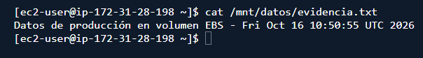